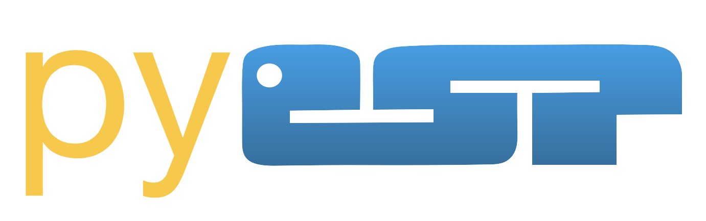

# PyCSP

A collection of tools based on Computational Singular Perturbation for the analysis of chemically reacting systems. 
Requires cantera >= 3.0, numpy, matplotlib, pandas. Tested with the latest Cantera release (3.2.0) and with Cantera 3.0. (for older versions of Cantera, i.e. Cantera>=2.5, download release v1.2.1)

Installation in a new environment called "pycsp" with Anaconda (suggested, otherwise skip to #3):
From PyCSP folder
1) conda create --name pycsp anaconda --file requirements.txt --channel default --channel anaconda --channel cantera
2) conda activate pycsp
3) pip install PyCSP-lib 


Testing (requires pytest):
1) from the PyCSP folder, run the command "pytest"
2) single test files can also be run as scripts from the tests/ folder (e.g. "python test_kernel.py") to plot their results

Several examples are available in the Examples folder to test the functionalities related to:
- exhausted modes (M) 
- tangential stretching rate (TSR)
- CSP and TSR indices (importance indices, amplitude and timescale participation indices, TSR amplitude/timescale participation indices)

Cantera chem-input files in .yaml format are required. Cantera offers a utility to convert chemkin-format files into cantera-format (ck2yaml): https://cantera.org/stable/userguide/ck2yaml-tutorial.html
Reduced (skeletal) mechanisms can be written with Cantera's own Solution.write_yaml() and Solution.write_chemkin().

FluidFoam (https://github.com/fluiddyn/fluidfoam) is suggested as a direct interface with openFOAM data.

# Warning
Datasets in the tsrAnalysis example folder are quite heavy. Due to limited github bandwidth, it may happen that "flamelet_state.dat" and "flamelet_rhsDiff.dat" are not correctly checked out. In that case, please write me an e-mail (riccardo.malpicagalassi [at] uniroma1.it). I will send you the files.

# Documentation
The documentation is available at https://rmalpica.github.io/PyCSP/ (sources in the docs/ folder, built with MkDocs).

# License
PyCSP is released under the Prosperity Public License 3.0.0 (noncommercial use). See the LICENSE file. For commercial use, please contact the author.

# How to cite?
This code has an associated publication. In addition to mentioning this GitHub repository (see below), I would be grateful if you could cite the publication: 
- Malpica Galassi, R., PyCSP: a Python package for the analysis and simplification of chemically reacting systems based on Computational Singular Perturbation, Computer Physics Communications, 2022, https://doi.org/10.1016/j.cpc.2022.108364.
(https://www.sciencedirect.com/science/article/pii/S0010465522000832)

BibTex citation of this publication:
```bibtex
@article{MALPICAGALASSI2022108364,
title = {PyCSP: a Python package for the analysis and simplification of chemically reacting systems based on Computational Singular Perturbation},
journal = {Computer Physics Communications},
pages = {108364},
year = {2022},
issn = {0010-4655},
doi = {https://doi.org/10.1016/j.cpc.2022.108364},
url = {https://www.sciencedirect.com/science/article/pii/S0010465522000832},
author = {Riccardo {Malpica Galassi}}
}

```

