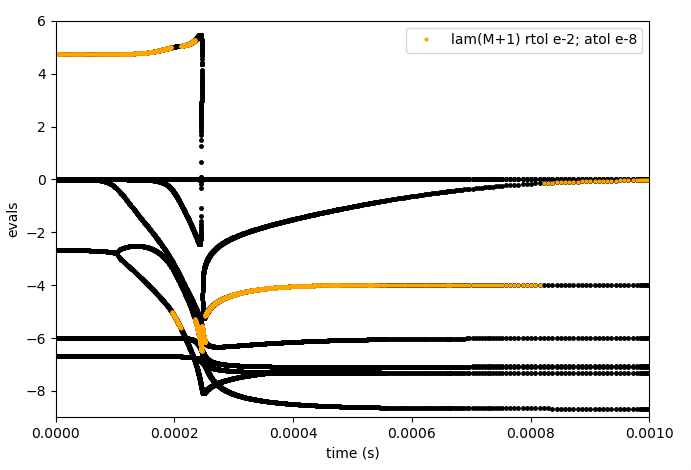
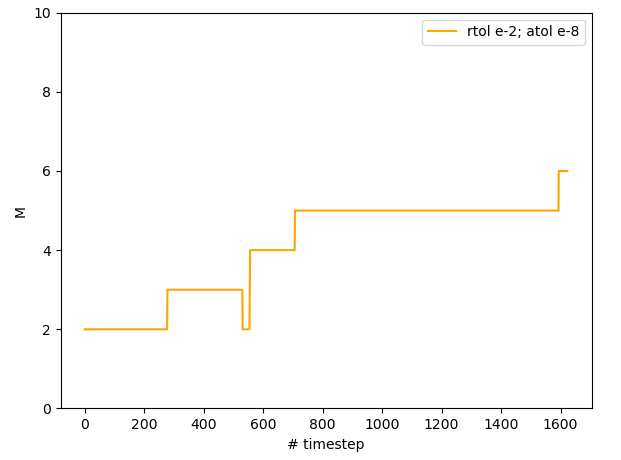
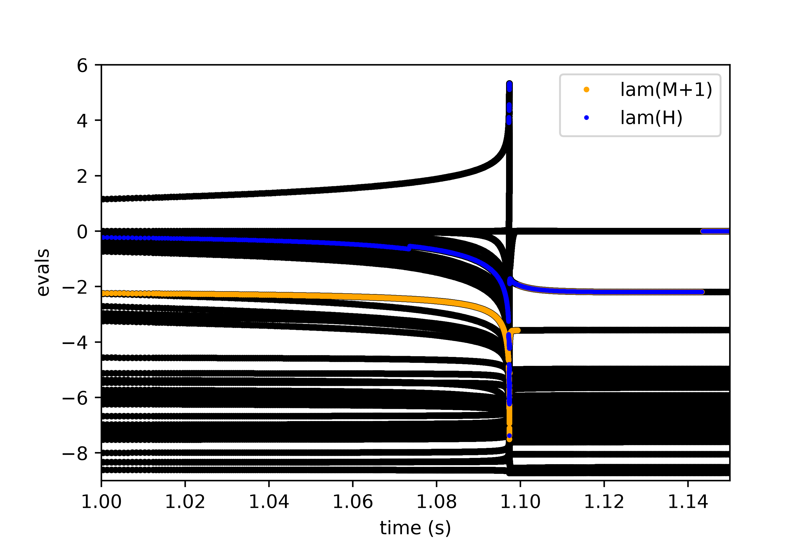

# CSP analysis

## Exhausted modes along a trajectory

This example analyses a set of thermochemical states stored in an external file called `testdata.dat`, containing $N$ lines, each one being a full thermochemical state of the kind [`t`, `T`, `P`, `Y_1`, ..., `Y_Ns`]. Such a file is written by `examples/dataImportExport/export_import.py`. The kinetic mechanism is `hydrogen.yaml`, containing 9 species and 19 reversible reactions. The dataset is the time evolution of a stoichiometric H$_2$/air constant-pressure homogeneous reactor, with an initial temperature of 1000 K and a pressure of one atmosphere.

```python
import numpy as np
import PyCSP.Functions as csp
import PyCSP.utils as utils
import matplotlib.pyplot as plt

#import dataset
data = np.loadtxt('testdata.dat')
time = data[:,0]
Temp = data[:,1]
Pressure = data[:,2]
Y = data[:,3:]

#create an instance of the CanteraCSP class
gas = csp.CanteraCSP('hydrogen.yaml')

#set jacobiantype
gas.jacobiantype = 'full'

#set CSP tolerances
gas.rtol = 1.0e-2
gas.atol = 1.0e-8

evals = []
M = []

for step in range(len(time)):
    gas.constP = Pressure[step]
    state = np.append(Y[step],Temp[step])
    gas.set_stateYT(state)
    lam,R,L,f = gas.get_kernel()
    NofDM = gas.calc_exhausted_modes()
    evals.append(lam)
    M.append(NofDM)

evals = np.array(evals)
M = np.array(M)

#plot eigenvalues and lambda_M+1
evalM = utils.select_eval(evals,M)
logevals = np.clip(np.log10(1.0+np.abs(evals)),0,100)*np.sign(evals.real)
logevalM = np.clip(np.log10(1.0+np.abs(evalM)),0,100)*np.sign(evalM.real)
fig, ax = plt.subplots(figsize=(6,4))
for idx in range(evals.shape[1]):
    ax.plot(time, logevals[:,idx], color='black', marker='.', markersize=5, linestyle='None')
ax.plot(time, logevalM, color='orange', marker='.', markersize=4, linestyle='None', label='lam(M+1) rtol e-2; atol e-8')
ax.set_xlabel('time (s)')
ax.set_ylabel('evals')
ax.set_ylim([-9, 6])
ax.set_xlim([0., 0.001])
ax.legend()
plt.show()

#plot exhausted modes
fig, ax = plt.subplots(figsize=(6,4))
ax.plot(M, color='orange', label='rtol e-2; atol e-8')
ax.set_xlabel('# timestep')
ax.set_ylabel('M')
ax.set_ylim([0,10])
ax.legend()
plt.show()
```

<div class="pycsp-row" markdown>
<figure markdown>

</figure>
<figure markdown>

</figure>
</div>
<p style="text-align:center"><em>Figure 2: Example outcomes. Left: eigenvalues (black) and M+1-th eigenvalue (orange). Right: number of exhausted modes.</em></p>

## Fast, active and slow subspaces

`calc_subspaces()` returns both the number of exhausted modes $M$ and the Head index $H$, which partition the modes into fast $[0, M)$, active $[M, H)$ and slow $[H, N_v - N_{el})$ subspaces (see [Theory](../theory/analysis.md#slow-modes)). The script `examples/cspAnalysis/subspaces.py` computes them along the ignition of a stoichiometric CH$_4$/air mixture (GRI-3.0, 1000 K, 1 atm):

```python
gas = csp.CanteraCSP('gri30.yaml')
...
while sim.time < 10:
    sim.step()
    states.append(r.thermo.state, t=sim.time)
    lam,R,L,f = gas.get_kernel()
    M, H = gas.calc_subspaces(rtolTail=1.0e-3,atolTail=1.0e-9,rtolHead=1.0e-3,atolHead=1.0e-9)
```

<figure markdown>
{ width="70%" }
<figcaption>Figure 3: Eigenvalues (black, log-scaled) during CH<sub>4</sub>/air ignition, with the eigenvalues of mode M+1 (orange) and of mode H (blue) bounding the active subspace. Generated with PyCSP v1.5.0.</figcaption>
</figure>

## Indices at a single state

`examples/cspAnalysis/indices.py` computes, at a given state, the CSP indices of all the reactions:

```python
api, tpi, ifast, islow, species_type = gas.calc_CSPindices(API=True, TPI=True, Impo=True, species_type=True)
tsrapi = gas.calc_TSRindices(type='amplitude')
tsrtpi = gas.calc_TSRindices(type='timescale')
```

The indices are arrays of shape [N$_v \times$ 2N$_r$] (modes for `api` and `tpi`, variables for `ifast` and `islow`), and the reaction names, forward and backward, are given by `gas.reaction_names()`. With `gas.index_norm = 'none'` the indices are not normalized and can be integrated in time (`indices-integral.py`).
