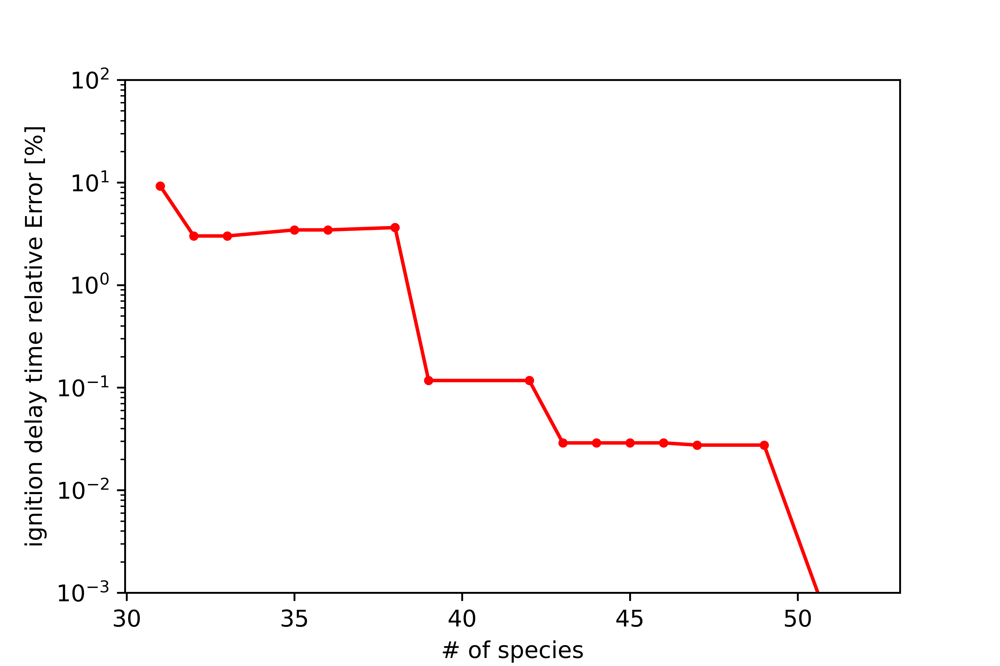
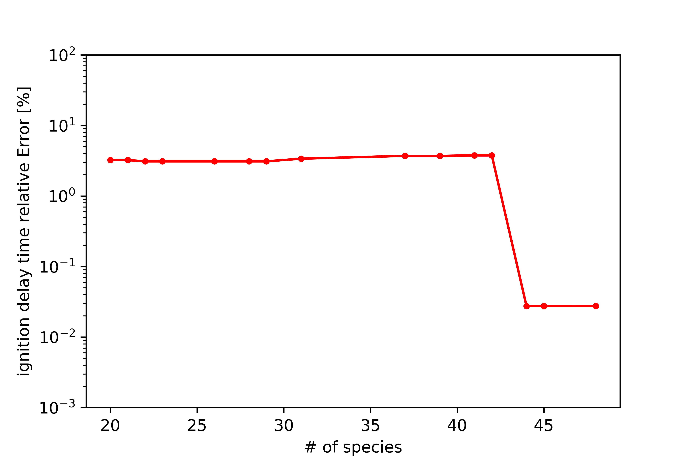

# CSP simplify

This example shows how to generate a set of simplified kinetic mechanisms with the `CSPsimplify` class, based on a dataset produced with a detailed mechanism (`examples/cspSimplify/simp.py`).

```python
import numpy as np
import cantera as ct
import matplotlib.pyplot as plt
import PyCSP.Functions as csp
import PyCSP.Simplify as simp
import PyCSP.utils as utils

#-------CREATE DATASET---------
#create gas from original mechanism file gri30.yaml
dtl_mech = csp.CanteraCSP('gri30.yaml')

#integrate ODE with detailed mech
T = 1000
P = ct.one_atm
states = utils.integrate_batch_constP(dtl_mech, T, P, 1.0, 'CH4', 'O2:1, N2:3.76', 1000)

dataset = np.concatenate((states.Y,states.T[:,np.newaxis],states.P[:,np.newaxis]),axis=1)
print('Dataset created, start processing...')

#coarsen dataset (to speed up)
dataset = dataset[::64]

#-------SIMPLIFY---------
#init simplifier
simplifier = simp.CSPsimplify(dtl_mech,dataset)

#simplifier settings
simplifier.targetset = {'CH4','O2','N2','HCO','H2O','CO2'}
simplifier.problemtype = 'constP'
simplifier.scaled = True
simplifier.csprtol = 1.0e-2
simplifier.cspatol = 1.0e-8

#process dataset
simplifier.process_dataset()

print('Done processing')

print('Start pruning...may take a while')
#loop over thresholds
thr = np.arange(0.01, 1, 0.01)

simp_mech = []
prev_species = dtl_mech.species_names
for i in range(len(thr)):
    species, reactions = simplifier.simplify_mechanism(thr[i])
    sk = csp.CanteraCSP(thermo='ideal-gas', kinetics='gas', species=species, reactions=reactions)
    if sk.species_names != prev_species:  #append only if different from previous one
        simp_mech.append(sk)
        prev_species = sk.species_names

nmech = len(simp_mech)
print('%i mechanisms found' % (nmech))

#-------RE-RUN---------
# Re-run the ignition problem with the simplified mechanisms
all_states_simp = []
for i in range(nmech):
    states_simp = utils.integrate_batch_constP(simp_mech[i], T, P, 1.0, 'CH4', 'O2:1, N2:3.76', 1000)
    all_states_simp.append(states_simp)

#-------ERRORS---------
dtl_idt = states.t[states.rhsT.argmax()]
simp_idt = np.array([all_states_simp[i].t[all_states_simp[i].rhsT.argmax()] for i in range(nmech)])
err_idt = abs((simp_idt-dtl_idt)/dtl_idt)*100

fig, ax = plt.subplots(figsize=(6,4))
ax.plot([simp_mech[i].n_species for i in range(nmech)], err_idt, color='red', marker='.')
ax.set_xlabel('# of species')
ax.set_ylabel('ignition delay time relative Error [%]')
ax.set_yscale('log')
ax.set_ylim([1e-3, 1e2])
plt.savefig('ign_delay_error.png', dpi=800, transparent=False)
```

A skeletal mechanism can be saved to file with Cantera's `write_yaml()` (or `write_chemkin()`) method, e.g. `simp_mech[i].write_yaml('skeletal.yaml')`.

<figure markdown>
{ width="70%" }
<figcaption>Figure 8: Example outcomes of the mechanism simplification.</figcaption>
</figure>

Figure 8 shows the percent relative error on the ignition delay time versus the number of retained species.
A significant improvement is given by the TSR kernel set, which replaces the user-specified target species set (see [[3]](../references.md#MalpicaGalassi2018)). With the following settings:

```python
simplifier.TSRtargetset = True
simplifier.TSRtol = 0.5
simplifier.targetset = {'N2'}
```

the previous example delivers the ignition delay relative errors shown in Figure 9. The manual addition of N$_2$ to the TSR kernel set is needed to force the presence of N$_2$ in the skeletal mechanisms.

<figure markdown>
{ width="70%" }
<figcaption>Figure 9: Example outcomes of the mechanism simplification with TSR kernel set.</figcaption>
</figure>
