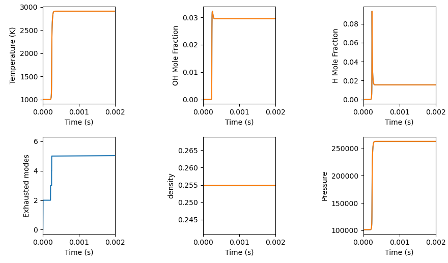

# CSP solver and G-Scheme

## CSP solver

This example shows how to integrate a constant-volume homogeneous reactor with the `CSPsolver` class (`examples/cspSolver/cspsolver_const_v.py`).

```python
import numpy as np
import cantera as ct
import PyCSP.Functions as cspF
import PyCSP.Solver as cspS

#create an instance of the CanteraCSP class
gas = cspF.CanteraCSP('hydrogen.yaml')

#set the gas state using Cantera's methods (as an alternative to set_stateYT())
T = 1000
P = ct.one_atm
gas.TP = T, P
gas.set_equivalence_ratio(1.0, 'H2', 'O2:1, N2:3.76')

#push density
rho = gas.density
gas.constRho = rho

#initial condition
y0 = np.hstack((gas.Y,gas.T))
t0 = 0.0

t_end = 1e-2

#create an instance of CSPsolver
solver = cspS.CSPsolver(gas)
solver.set_integrator(cspRtol=1e-2,cspAtol=1e-8,factor=0.2,jacobiantype='full')
solver.set_initial_value(y0,t0)

states = ct.SolutionArray(gas, 1, extra={'t': [0.0], 'M': 0})

#integrate ODE with CSP solver
while solver.t < t_end:
    solver.integrate()
    states.append(gas.state, t=solver.t, M=solver.M)
    print('%10.3e %10.3f %10.3e %10.3e %10.3e %2i' % (solver.t, solver.y[-1], solver.dt, gas.P, gas.density, solver.M))
```

<figure markdown>

<figcaption>Figure 7: Example outcomes: temperature, OH, H, number of exhausted modes, density and pressure in a constant-volume reactor integrated with the CSP solver.</figcaption>
</figure>

## G-Scheme

The G-Scheme integrates only the active modes, between the Tail ($T$) and Head ($H$) indices (`examples/cspSolver/gscheme_const_p.py`):

```python
import PyCSP.GScheme as gsc

gas = cspF.CanteraCSP('gri30.yaml')
gas.TP = 1000, ct.one_atm
gas.set_equivalence_ratio(1.0, 'CH4', 'O2:1, N2:3.76')
gas.constP = ct.one_atm

y0 = np.hstack((gas.Y,gas.T))
solver = gsc.GScheme(gas)
solver.set_integrator(cspRtolTail=1e-3,cspAtolTail=1e-9,cspRtolHead=1e-4,cspAtolHead=1e-10,
                      factor=0.25,jacobiantype='full')
solver.set_initial_value(y0,0.0)

states = ct.SolutionArray(gas, 1, extra={'t': [0.0], 'Tail': 0, 'Head': 0, 'dt': [0.0]})
while solver.t < 2.0:
    solver.integrate()
    states.append(gas.state, t=solver.t, Tail=solver.T, Head=solver.H, dt=solver.dt)

solver.profiling()
```

With `solver.reuse = True` the CSP basis is reused while the Jacobian diagonal changes by less than `solver.reuseThr` (`gscheme_const_p_reuse.py`).
