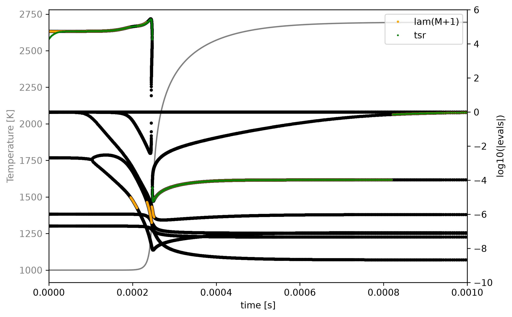
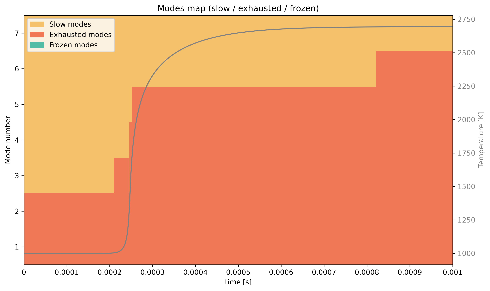
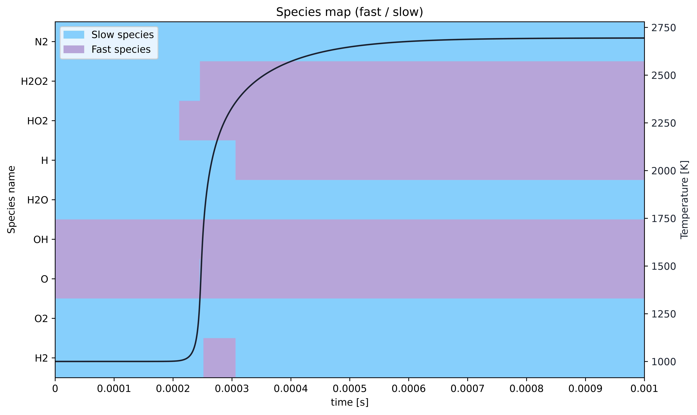

# Full CSP analysis and plots

The script `examples/cspAnalysis/full_CSP_analysis.py` runs a complete CSP analysis of the H$_2$/air constant-pressure ignition. It stores the results in a `utils.TaggedDatabase` and generates all the plots with `utils.save_CSP_plots`. This workflow is new in the v1.5 documentation.

```python
import numpy as np
import PyCSP.Functions as csp
import PyCSP.utils as utils

gas = csp.CanteraCSP('hydrogen.yaml')
P = 101325.0
states = utils.integrate_batch_constP(gas, 1000.0, P, 1.0, 'H2', 'O2:1, N2:3.76', 1e-3)

db = utils.TaggedDatabase()
for step in range(len(states.t)):
    stateYT = np.append(states.Y[step], states.T[step])
    gas.constP = P
    gas.jacobiantype = 'full'
    gas.set_stateYT(stateYT)

    lam, R, L, f = gas.get_kernel()
    frozen = csp.detectFrozenModes(gas.nv-gas.n_elements, stateYT, R, L,
                                   gas.generalized_Stoich_matrix, gas.R_vector, 1e-4, 1e-12)
    M = gas.calc_exhausted_modes()
    api, tpi, ifast, islow, species_type = gas.calc_CSPindices(API=True, Impo=True, species_type=True)

    db.store(time=states.t[step], state=stateYT, evals=lam, Revec=R, Levec=L, fvec=f,
             M=M, frozen=frozen, tsr=gas.calc_TSR(), API=api, Ifast=ifast, Islow=islow,
             species_type=species_type, Pointers=csp.CSP_pointers(R, L),
             tsrApi=gas.calc_TSRindices(type='amplitude'),
             tsrTpi=gas.calc_TSRindices(type='timescale'))

db.to_arrays()
utils.save_CSP_plots(db, gas, output_folder='CSP_Plots', threshold=0.2,
                     species_threshold=1e-4, xlim=(0, 0.001), xlabel='time [s]')
```

The tags recognized by `save_CSP_plots` are listed in the [`utils.py`](../api/utils.md) page. Some of the plots generated by the script are shown below.

<figure markdown>
{ width="75%" }
<figcaption>Figure 4: Eigenvalues (black), eigenvalue of mode M+1 (orange) and TSR (green), together with temperature (grey). Generated with PyCSP v1.5.0.</figcaption>
</figure>

<figure markdown>
{ width="75%" }
<figcaption>Figure 5: Map of the slow, exhausted and frozen modes during the ignition. Generated with PyCSP v1.5.0.</figcaption>
</figure>

<figure markdown>
{ width="75%" }
<figcaption>Figure 6: Map of the fast and slow species, from the CSP pointers. Generated with PyCSP v1.5.0.</figcaption>
</figure>
