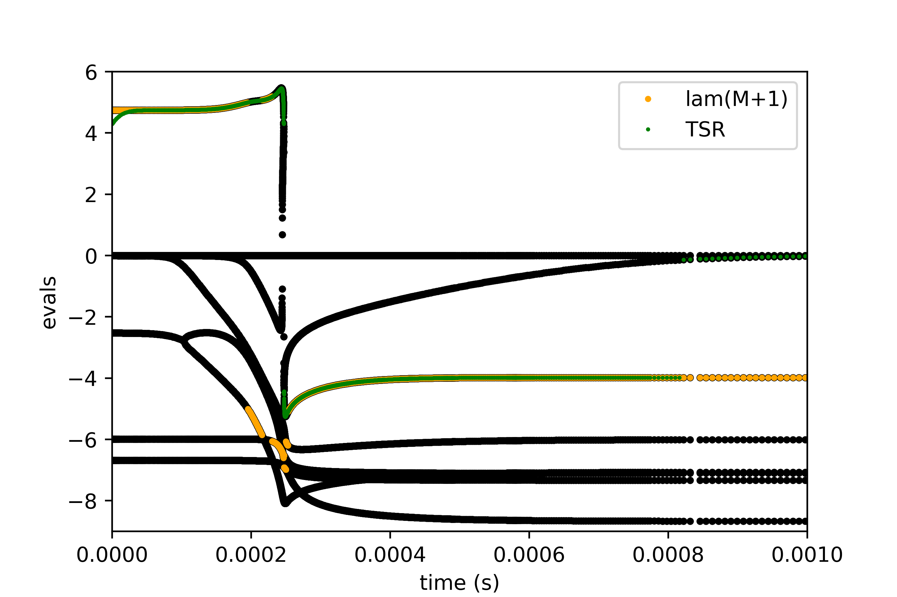
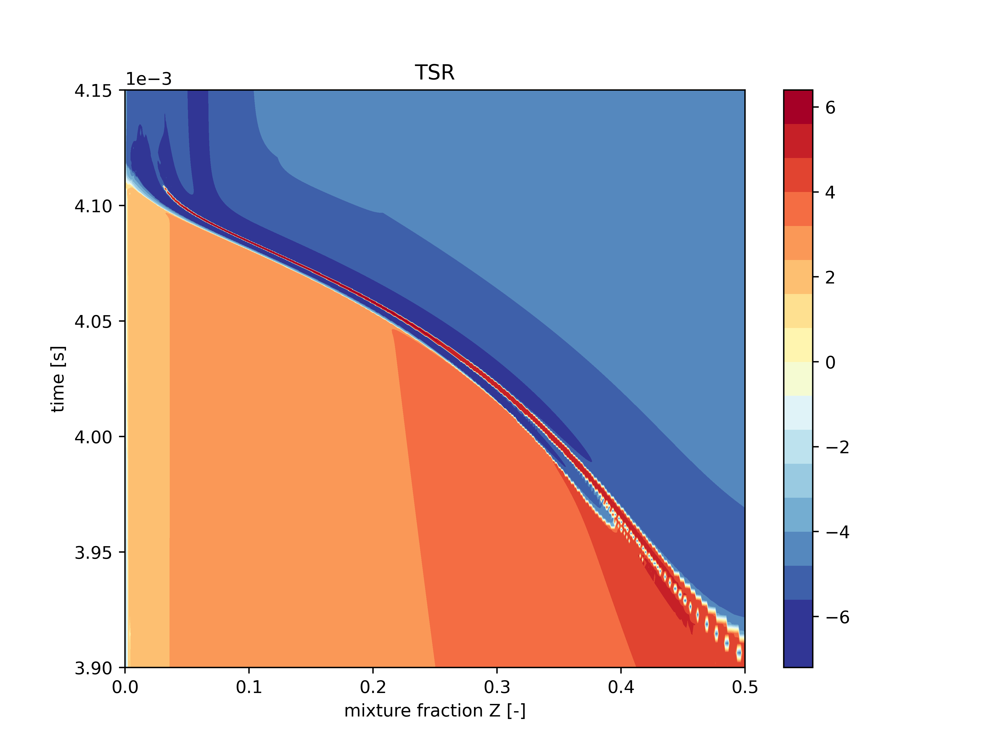
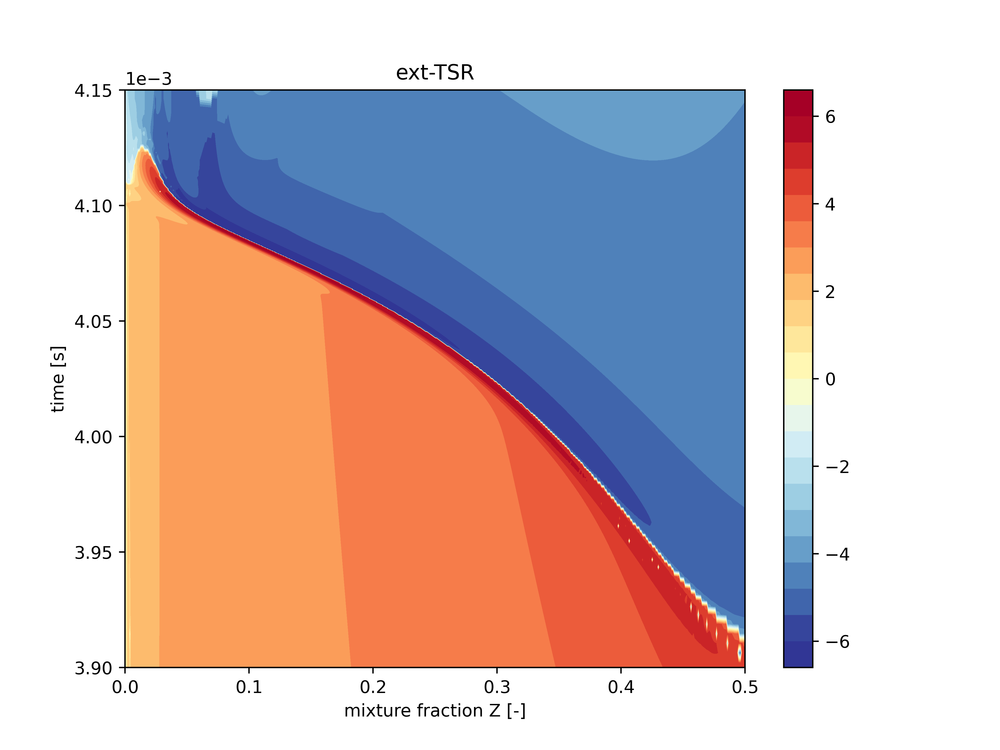
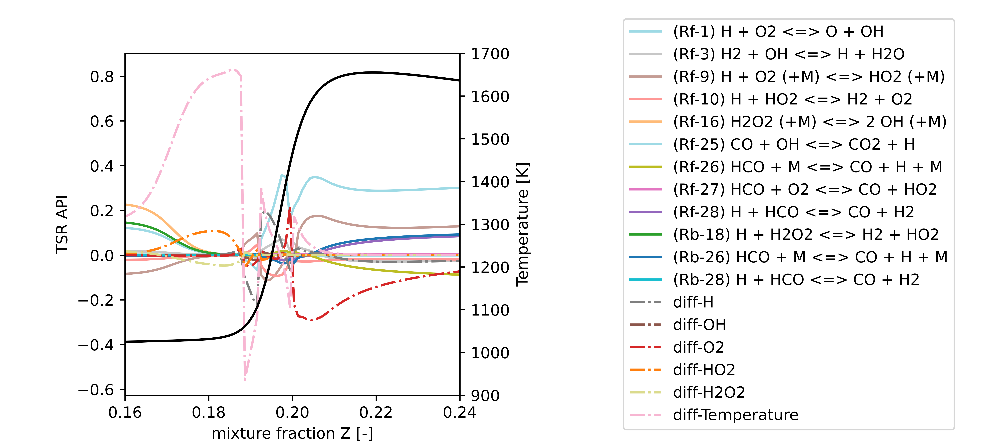

# TSR analysis

## Chemical TSR

This example shows how to compute the TSR of data points produced in a homogeneous reactor auto-ignition (`examples/tsrAnalysis/TSR.py`).

```python
import numpy as np
import cantera as ct
import matplotlib.pyplot as plt
import PyCSP.Functions as csp
import PyCSP.utils as utils

#create gas from original mechanism file hydrogen.yaml
gas = csp.CanteraCSP('hydrogen.yaml')

#set the gas state
T = 1000
P = ct.one_atm
gas.TP = T, P
gas.set_equivalence_ratio(1.0, 'H2', 'O2:1, N2:3.76')
gas.constP = P
gas.jacobiantype = 'full'

#integrate ODE
r = utils.shared_reactor(ct.IdealGasConstPressureReactor, gas)
sim = ct.ReactorNet([r])
states = ct.SolutionArray(gas, extra=['t'])

evals = []
M = []
tsr = []

while sim.time < 10:
    sim.step()
    states.append(gas.state, t=sim.time)
    lam,R,L,f = gas.get_kernel()
    omegatau, NofDM = gas.calc_TSR(getM=True,rtol=1.0e-3,atol=1.0e-10)
    evals.append(lam)
    M.append(NofDM)
    tsr.append(omegatau)

evals = np.array(evals)
M = np.array(M)
tsr = np.array(tsr)

#plot eigenvalues, lambda_M+1 and TSR
evalM = utils.select_eval(evals,M)
logevals = np.clip(np.log10(1.0+np.abs(evals.real)),0,100)*np.sign(evals.real)
logevalM = np.clip(np.log10(1.0+np.abs(evalM.real)),0,100)*np.sign(evalM.real)
logTSR = np.clip(np.log10(1.0+np.abs(tsr)),0,100)*np.sign(tsr)
fig, ax = plt.subplots(figsize=(6,4))
for idx in range(evals.shape[1]):
    ax.plot(states.t, logevals[:,idx], color='black', marker='.', markersize=5, linestyle='None')
ax.plot(states.t, logevalM, color='orange', marker='.', markersize=4, linestyle='None', label='lam(M+1)')
ax.plot(states.t, logTSR, color='green', marker='.', markersize=2, linestyle='None', label='TSR')
ax.set_xlabel('time (s)')
ax.set_ylabel('evals')
ax.set_ylim([-9, 6])
ax.set_xlim([0., 0.001])
ax.legend()
plt.savefig('TSR.png', dpi=500, transparent=False)
```

<figure markdown>
{ width="70%" }
<figcaption>Figure 10: Example outcomes of the TSR analysis.</figcaption>
</figure>

Figure 10 shows the TSR compared to the system's eigenvalues.

## Extended TSR

This example shows how to perform an extended TSR analysis of pre-computed thermochemical data stored in two external files:

- `flamelet_state.dat` contains $N$ lines, each one being a full thermochemical state of the kind [`time`, `counter`, `Z`, `P`, `T`, `Y_1`, ..., `Y_Ns`];
- `flamelet_rhsDiff.dat` contains the diffusive terms, in the form [`time`, `counter`, `Z`, `diff-T`, `diff-Y_1`, ..., `diff-Y_Ns`].

This analysis can be performed supplying either the diffusive terms, the convective terms, or both simultaneously.
The kinetic mechanism is `chaos12.yaml`, containing 12 species and 33 reversible reactions. The dataset and the results are described in [[4]](../references.md#Valorani2017) (`examples/tsrAnalysis/TSR_ext.py`).

```python
import numpy as np
import PyCSP.Functions as csp

#create gas from original mechanism file chaos12.yaml
gas = csp.CanteraCSP('chaos12.yaml')

#-------IMPORT DATA---------
#read data from file
state = np.loadtxt('flamelet_state.dat')
time = state[:,0]
counter = state[:,1]
zeta = state[:,2]
Pressure = state[:,3]
Temp = state[:,4]
Y = state[:,5:]

rhsD = np.loadtxt('flamelet_rhsDiff.dat')
diffTemp = rhsD[:,3]
diffY = rhsD[:,4:]

#set jacobiantype
gas.jacobiantype = 'full'

evals = []
M = []
tsr = []
Mext = []
tsrext = []

print('Analyzing %i data points, may take a while...' %len(state))

for step in range(time.shape[0]):
    gas.constP = Pressure[step]
    stateYT = np.append(Y[step],Temp[step])
    rhsdiffYT = np.append(diffY[step],diffTemp[step])
    gas.set_stateYT(stateYT)
    lam,R,L,f = gas.get_kernel()
    omegatau, NofDM = gas.calc_TSR(getM=True)
    omegatauext, NofDMext = gas.calc_extended_TSR(getMext=True,diff=rhsdiffYT)

    evals.append(lam)
    M.append(NofDM)
    tsr.append(omegatau)
    Mext.append(NofDMext)
    tsrext.append(omegatauext)

evals = np.array(evals)
Mext = np.array(Mext)
tsrext = np.array(tsrext)
M = np.array(M)
tsr = np.array(tsr)
```

Figure 11 shows the contour plots of the chemical and extended TSR.

<div class="pycsp-row" markdown>
<figure markdown>

</figure>
<figure markdown>

</figure>
</div>
<p style="text-align:center"><em>Figure 11: Example outcomes. Left: contour plot of the chemical TSR. Right: contour plot of the extended TSR.</em></p>

The amplitude participation indices (API) to the extended TSR can be obtained as:

```python
omegatauext, api = gas.calc_extended_TSRindices(diff=rhsdiffYT, getTSRext=True)
```

The indices refer to the 2N$_r$ reactions followed by the N$_v$ convective and the N$_v$ diffusive terms. Figure 12 shows the TSR-API in a slice of the field.

<figure markdown>
{ width="90%" }
<figcaption>Figure 12: Example outcomes. Amplitude Participation Indices to the extended TSR.</figcaption>
</figure>
