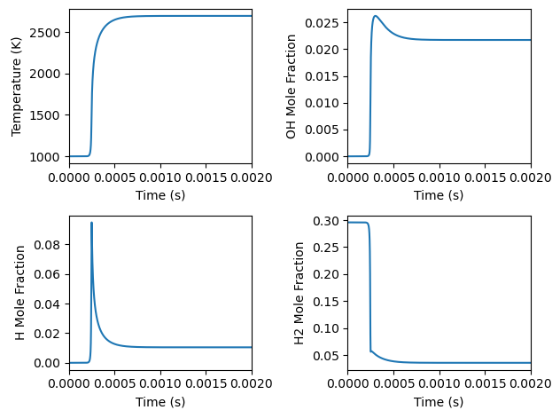
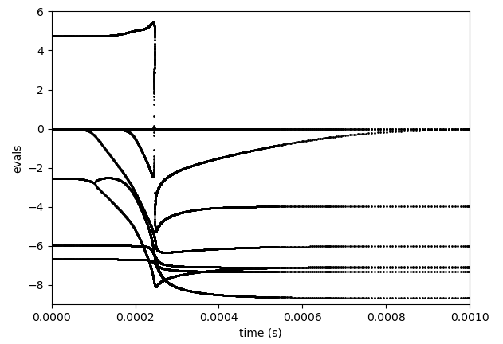

# Installation

## Prerequisites

PyCSP relies on Cantera &ge; 3.0.0, numpy and matplotlib. Pandas is required as well for minor functions such as profiling. PyCSP v1.5.0 works with the **latest Cantera release (3.2.0)**: the full test-suite passes with Cantera 3.2.0 (Python 3.12, numpy 2) as well as with the oldest supported version, Cantera 3.0 (Python 3.10, numpy 1.23). The continuous-integration workflow tests Cantera 3.0, 3.1 and the latest release on every change. The Python version must comply with Cantera.

For older versions of Cantera (2.5), download release v1.2.1.

## Installation

PyCSP is available on PyPI as `PyCSP-lib`:

```console
$ pip install PyCSP-lib
```

Installation using Anaconda is recommended. In such case, proceed as follows via command line:

```console
$ git clone https://github.com/rmalpica/PyCSP.git
$ cd $PATH_TO_PyCSP_MAIN_FOLDER
$ conda create --name pycsp --channel conda-forge python=3.12 cantera numpy matplotlib pandas
$ conda activate pycsp
$ pip install $PATH_TO_PyCSP_MAIN_FOLDER
```

Alternatively, once the prerequisite libraries are installed, the installation may be performed via command line as follows:

```console
$ git clone https://github.com/rmalpica/PyCSP.git
$ pip install $PATH_TO_PyCSP_MAIN_FOLDER
```

Use `pip install -e $PATH_TO_PyCSP_MAIN_FOLDER` for an editable (development) installation.

## Testing

The test-suite uses [pytest](https://pytest.org). To test the installation, proceed as follows via command line:

```console
$ cd $PATH_TO_PyCSP_MAIN_FOLDER
$ pip install pytest
$ pytest
```

The suite contains:

| File | Content |
|---|---|
| `test_rhs.py`, `test_rhs_constV.py` | The chemical source term equals $\mathcal{S}\,\mathbf{r}$ and the Cantera net production rates, at constant pressure and constant volume. |
| `test_kernel.py` | Properties of the CSP kernel along an H$_2$/air ignition: bi-orthonormality, ordering, conserved modes, $\mathbf{g} = \mathbf{A}\,\mathbf{f}$. |
| `test_correctness.py` | Jacobians against independent references (constraint, chain rule, elemental conservation, constrained manifold), sum of per-reaction contributions, TPI decomposition of the eigenvalues, state restoration. |
| `test_norm_cut.py` | The optional `norm_cut` of the CSP indices. |
| `test_utils_and_solvers.py` | Utilities, simplifier and CSP integrators. |
| `test_golden.py` | Golden-master regression: kernel, M, H, TSR, projectors and indices at stored states, CSP solver, G-Scheme and simplifier runs. |

The test files `test_kernel.py`, `test_rhs.py` and `test_rhs_constV.py` can also be run as scripts from the `tests` folder, to plot their results:

```console
$ cd tests
$ python test_kernel.py
```

`test_kernel.py` plots the evolution of the system's eigenvalues during the ignition of a constant-pressure reactor.

<div class="pycsp-row" markdown>
<figure markdown>

</figure>
<figure markdown>

</figure>
</div>
<p style="text-align:center"><em>Figure 1: Typical results: time evolution of temperature, OH, H and H<sub>2</sub> in a constant-pressure reactor (left) and of the system's eigenvalues (right).</em></p>

!!! info "Golden masters"
    The reference data of `test_golden.py` are stored in `tests/golden/golden_h2.npz`. They are regenerated only on purpose, after a deliberate and reviewed change of results, with `python tests/golden/make_golden.py`.
